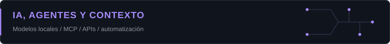
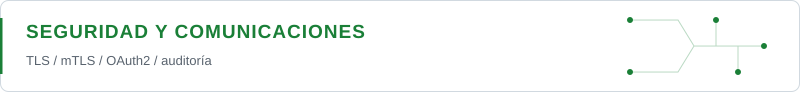
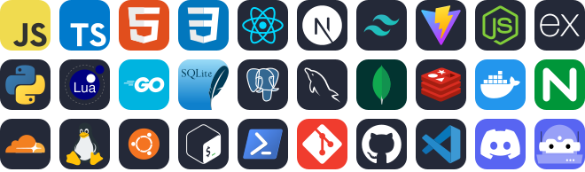
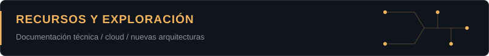

<h1 align="center">Emanuel Duarte</h1>

  <strong>Desarrollo full stack · Infraestructura de IA · Automatización</strong> 
  Aplicaciones, agentes de IA y servicios conectados mediante APIs y MCP. 
  Buenos Aires, Argentina

  

  
  

  
  
  

## Enfoque actual

| Infraestructura y operación | IA y agentes | Integración y seguridad |
| --- | --- | --- |
| Ingeniería de plataformas | Infraestructura de IA | Model Context Protocol (MCP) |
| Automatización DevOps | Agentes y coordinación multiagente | APIs y acceso a datos |
| Contenedores y servicios | Operación de modelos locales | Ingeniería de contexto |
| Observabilidad y diagnóstico | Automatización con IA | Autenticación y comunicaciones cifradas |

## IA, agentes y contexto

Integro modelos y agentes de IA con servicios, APIs y bases de datos, con foco en automatización, observabilidad y control de accesos.

- **Infraestructura de IA:** modelos locales, inferencia en nodos dedicados y gestión de recursos.
- **Agentes y contexto:** MCP, acceso a APIs y SQLite, memoria consultable y coordinación de tareas.
- **Automatización:** flujos con n8n, colas de trabajo y generación de reportes.

## Infraestructura y conectividad

- **Plataforma:** Linux/Ubuntu, Docker Compose, Portainer y administración por SSH.
- **Cloudflare:** DNS, publicación mediante Cloudflare Tunnel y HTTPS hacia el origen.
- **Operación:** monitorización con Uptime Kuma, registros, diagnóstico de recursos y copias de seguridad con rclone y Google Drive.

## Seguridad y comunicaciones

- **Comunicaciones:** TLS/mTLS, certificados y autenticación entre servicios.
- **Aplicaciones:** OAuth2 con PKCE, sesiones, permisos, protección CSRF y límites de peticiones.
- **Auditoría:** revisión de código y dependencias, análisis de CVE y documentación de evidencias.
- **Acceso y red:** firewall, aislamiento de servicios y permisos de administración.

## Tecnologías y herramientas

  

  

## Capacidades técnicas

| Desarrollo e integración | Infraestructura | IA y automatización | Seguridad y operación |
| --- | --- | --- | --- |
| Frontend y backend | Linux / Ubuntu | Agentes de IA | TLS / mTLS |
| APIs y bases de datos | Docker / Compose | MCP y herramientas | OAuth2 / PKCE |
| Bots e integraciones | Cloudflare Tunnel | Contexto y memoria | Control de permisos |
| Paneles de administración | SSH / Portainer | n8n y colas de trabajo | Auditoría y análisis de CVE |
| SQLite y servicios de datos | Monitores y backups | Reportes automatizados | Registros y trazabilidad |

## Recursos y exploración

### Áreas de exploración

| Cloud y plataformas | Operación de modelos | Frameworks y arquitecturas |
| --- | --- | --- |
| AWS y arquitectura cloud | MLOps / LLMOps | LangChain / LangGraph |
| Kubernetes | Evaluación de modelos | Google ADK |
| GitOps | Retrieval-Augmented Generation (RAG) | Agent2Agent (A2A) |

### Biblioteca técnica

Referencias oficiales de trabajo y aprendizaje. Incluye herramientas actuales y tecnologías para explorar.

<strong>Infraestructura, Linux y contenedores</strong> · 7 recursos

| Recurso | Qué podés encontrar |
| --- | --- |
| [Ubuntu Server](https://documentation.ubuntu.com/server/) | Administración y operación de servidores. |
| [Docker Engine](https://docs.docker.com/engine/) | Imágenes, contenedores, redes y almacenamiento. |
| [Docker Compose](https://docs.docker.com/compose/) | Definición y operación de servicios. |
| [Portainer](https://docs.portainer.io/) | Gestión de entornos y stacks. |
| [NGINX](https://nginx.org/en/docs/) | Proxy inverso y publicación web. |
| [Kubernetes](https://kubernetes.io/docs/home/) | Orquestación y operación de clústeres. |
| [OpenGitOps](https://opengitops.dev/) | Principios de gestión declarativa desde Git. |

<strong>Cloudflare, cifrado y seguridad</strong> · 8 recursos

| Recurso | Qué podés encontrar |
| --- | --- |
| [Cloudflare Tunnel](https://developers.cloudflare.com/cloudflare-one/networks/connectors/cloudflare-tunnel/) | Túneles y conectividad con el origen. |
| [Cloudflare DNS](https://developers.cloudflare.com/dns/) | Zonas, registros y resolución DNS. |
| [Cloudflare SSL/TLS](https://developers.cloudflare.com/ssl/) | HTTPS, certificados y configuración del origen. |
| [Certificados cliente y mTLS](https://developers.cloudflare.com/ssl/client-certificates/) | Autenticación mediante certificados cliente. |
| [Cloudflare Access](https://developers.cloudflare.com/cloudflare-one/access-controls/) | Políticas de acceso a aplicaciones. |
| [OWASP Cheat Sheets](https://cheatsheetseries.owasp.org/) | Guías de autenticación, sesiones y seguridad web. |
| [Trivy](https://trivy.dev/docs/latest/) | Vulnerabilidades y configuraciones de contenedores. |
| [Semgrep](https://semgrep.dev/docs/) | Análisis estático de código. |

<strong>IA, modelos y agentes</strong> · 9 recursos

| Recurso | Qué podés encontrar |
| --- | --- |
| [MCP](https://modelcontextprotocol.io/docs/getting-started/intro) | Herramientas y fuentes de contexto para asistentes. |
| [Ollama](https://docs.ollama.com/) | Ejecución e integración de modelos locales. |
| [llama.cpp](https://github.com/ggml-org/llama.cpp) | Inferencia local y formatos de modelos. |
| [Hugging Face](https://huggingface.co/docs) | Modelos, datasets y bibliotecas de IA. |
| [vLLM](https://docs.vllm.ai/en/latest/) | Servicio y optimización de inferencia. |
| [LangChain](https://docs.langchain.com/oss/python/langchain/overview) | Agentes e integración de herramientas. |
| [LangGraph](https://docs.langchain.com/oss/python/langgraph/overview) | Flujos y agentes con estado. |
| [Google ADK](https://adk.dev/) | Desarrollo y coordinación de agentes. |
| [Agent2Agent (A2A)](https://a2a-protocol.org/latest/) | Interoperabilidad entre agentes. |

<strong>Automatización, cloud y entrega</strong> · 6 recursos

| Recurso | Qué podés encontrar |
| --- | --- |
| [n8n](https://docs.n8n.io/) | Flujos de trabajo e integraciones. |
| [GitHub Actions](https://docs.github.com/en/actions) | Automatización de repositorios y CI/CD. |
| [AWS Architecture Center](https://aws.amazon.com/architecture/) | Referencias y patrones de arquitectura cloud. |
| [Terraform](https://developer.hashicorp.com/terraform/docs) | Infraestructura declarativa como código. |
| [Ansible](https://docs.ansible.com/projects/ansible/latest/) | Configuración y automatización de sistemas. |
| [PowerShell](https://learn.microsoft.com/en-us/powershell/) | Administración y automatización con scripts. |

<strong>Observabilidad y copias de seguridad</strong> · 6 recursos

| Recurso | Qué podés encontrar |
| --- | --- |
| [Uptime Kuma](https://github.com/louislam/uptime-kuma/wiki) | Monitores, comprobaciones y avisos. |
| [OpenTelemetry](https://opentelemetry.io/docs/) | Instrumentación, métricas, trazas y logs. |
| [Prometheus](https://prometheus.io/docs/introduction/overview/) | Métricas y reglas de alertas. |
| [Grafana](https://grafana.com/docs/grafana/latest/) | Visualización y paneles de observabilidad. |
| [rclone](https://rclone.org/docs/) | Transferencias y copias a almacenamiento remoto. |
| [restic](https://restic.readthedocs.io/en/stable/) | Copias cifradas y restauración. |

<strong>Desarrollo, APIs y datos</strong> · 10 recursos

| Recurso | Qué podés encontrar |
| --- | --- |
| [MDN Web Docs](https://developer.mozilla.org/en-US/docs/Web) | HTML, CSS, JavaScript y APIs del navegador. |
| [TypeScript](https://www.typescriptlang.org/docs/) | Tipos y herramientas para JavaScript. |
| [Node.js](https://nodejs.org/en/docs) | Runtime y APIs para backend. |
| [React](https://react.dev/learn) | Interfaces y componentes. |
| [Next.js](https://nextjs.org/docs) | Aplicaciones web con React. |
| [Python](https://docs.python.org/3/) | Lenguaje, biblioteca estándar e integración. |
| [SQLite](https://sqlite.org/docs.html) | SQL, transacciones y almacenamiento local. |
| [PostgreSQL](https://www.postgresql.org/docs/) | Administración y desarrollo con SQL. |
| [Redis](https://redis.io/docs/latest/) | Caché y estructuras de datos. |
| [Discord Developer Docs](https://docs.discord.com/developers/intro) | Bots, OAuth2 e integraciones con Discord. |

## GitHub

  
  

  

